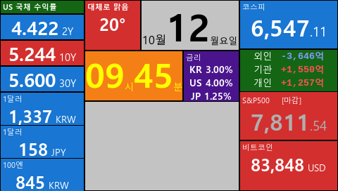

# 📊 MacroMonitor GTK Dashboard

> **STM32MP1 (Embedded Linux)** 및 **Windows PC** 환경에서 실시간 금융/기상 데이터를 모니터링하기 위해 개발된 크로스 플랫폼 GTK3 대시보드 애플리케이션입니다.

---

## 📸 Dashboard Preview



---

## ✨ Key Features

- **미국 국채 수익률 (US Treasury Yields)**
  - `2Y`: FRED(미국 연준) API (`DGS2`) 기반 실시간 현물 금리 수집
  - `10Y / 30Y`: 야후 파이낸스 v8 API 기반 실시간 수집
- **국내/해외 주요 증시 지수**: KOSPI, S&P 500, 비트코인(USD) 가격 및 일별 변동 반영
- **투자 주체별 매매 동향**: 외국인, 기관, 개인 순매수/순매도 금액 동향
- **환율 정보**: USD/KRW, USD/JPY, JPY/KRW 실시간 환율
- **날씨 & 온도**: Open-Meteo API 기반 WMO 날씨 코드를 한글 텍스트("맑음", "구름 조금" 등)로 정밀 매핑
- **시스템 최적화**: 
  - 상태 변화 감지 조건문 적용으로 불필요한 UI 재렌더링 방지 (CPU 점유율 극소화)
  - `curl` 기반 소켓 처리 및 SSL Context 세션 타임아웃 예외 처리 적용

---

## 🛠️ Tech Stack & Requirements

- **Language**: Python 3.x
- **GUI Framework**: PyGObject (GTK+ 3, Pango Markup)
- **Target OS**: Linux (Yocto / STM32MP1 Embedded), Windows 10/11
- **Dependencies**: `curl`, `python3-gi`, `python3-gi-cairo`

---

## 🚀 Getting Started

### 1. Linux (STM32MP1 / Ubuntu / Debian)
ST OpenSTLinux - Weston - (A Yocto Project Based Distro) 5.0.15-openstlinux-6.6-yocto-scarthgap-mpu-v26.02.18
윈도우용은 확인중 입니다.

#### 필수 설치 스크립트 실행 (`install_stm32mp1/install.sh`)
의존성 패키지 설치부터 부팅 시 자동 실행을 위한 `systemd` 서비스 등록까지 한 번에 완료됩니다.

```bash
git clone [https://github.com/lib-birdbell/macro-monitor.git](https://github.com/lib-birdbell/macro-monitor.git)
cd macro-monitor/install_stm32mp1
chmod +x install.sh
sudo ./install.sh
```

### 2. Windows (10 / 11)
Releases 에서 받은 파일을 실행합니다.  
글씨 비율이 안맞을때는, 시스템 > 디스플레이에서 배율을 100%로 설정합니다.

